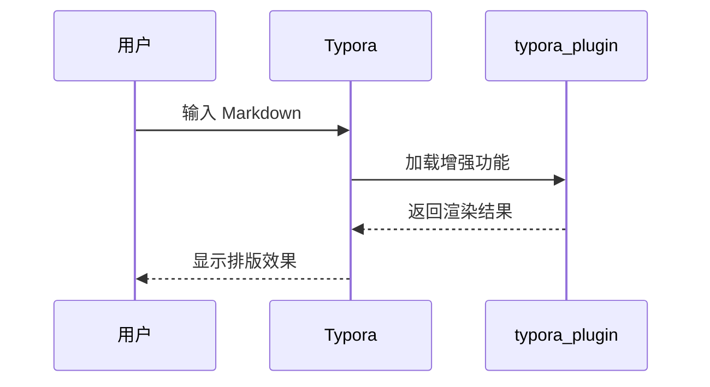
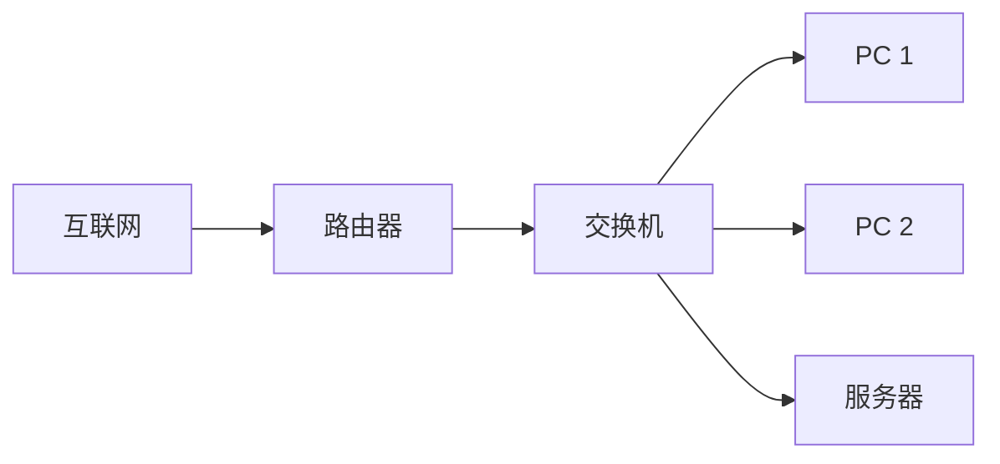

# Markdown 语法与 Typora（typora_plugin）速查表

> 适用环境：Windows + Typora 1.8.10 + typora_plugin 1.11.34
>
> 使用方式：在 Typora 中打开本文件。看源码时按 `Ctrl + /` 切换源码模式；需要复制示例时，复制代码块内的内容即可。
>
> 版本说明：typora_plugin 的菜单名称、快捷键和可配置项可能随版本或个性化设置变化。本表按 1.11.x 常见功能整理，遇到名称差异时，以你当前“插件设置”面板中的实际名称为准。

---

# 一、基础语法

## 1. 标题层级（H1-H6）与段落换行

### 源码

````markdown
# 一级标题 H1
## 二级标题 H2
### 三级标题 H3
#### 四级标题 H4
##### 五级标题 H5
###### 六级标题 H6

这是第一段。

这是第二段。段与段之间空一行。

这是同一段中的第一行，  
行尾输入两个空格后换行，得到硬换行。

也可以使用 <br> 强制换行。
````

### 效果说明

- `#` 的数量决定标题级别，`#` 后建议保留一个空格。
- H1 最大，H6 最小。Typora 的侧边栏大纲会按标题层级生成。
- 普通换行：直接回车，Typora 通常会将其视为同一段的一部分。
- 新段落：标题或段落后空一行，再写下一段。
- 硬换行：行尾输入两个空格后回车，或使用 `<br>`。
- Typora 中也可以用 `Ctrl + 1` 到 `Ctrl + 6` 快速切换标题级别，`Ctrl + 0` 恢复为普通段落。

## 2. 文本样式（加粗、斜体、高亮、删除线）

### 源码

````markdown
**加粗**

*斜体*

_也可以表示斜体_

***加粗并斜体***

==高亮==

~~删除线~~

`行内代码`

普通文本中可以组合使用：这是 **加粗**、*斜体*、==高亮==、~~删除线~~。
````

### 效果说明

**这是加粗效果。**

*这是斜体效果。*

***这是加粗并斜体效果。***

==这是高亮效果。==

~~这是删除线效果。~~

`这是行内代码效果。`

使用建议：

- 加粗用于关键结论、按钮名、菜单项。
- 斜体用于英文书名、术语强调，不建议整段使用。
- 高亮适合提醒重点，但部分 Markdown 平台不兼容，导出 HTML/PDF 时通常可保留。
- 删除线适合记录修改或废弃内容。
- 行内代码适合写命令、路径、变量名、文件名。

## 3. 列表（有序、无序、嵌套列表、任务列表）

### 无序列表

````markdown
- 苹果
- 香蕉
- 橙子

* 也可以使用星号
* 第二项

+ 也可以使用加号
+ 第二项
````

效果说明：渲染为圆点列表。实际写作时建议统一使用 `-`，更易读。

### 有序列表

````markdown
1. 打开 Typora
2. 新建 Markdown 文件
3. 输入内容并保存
````

效果说明：Typora 会自动按 1、2、3 编号。源文件中的数字不连续时，部分渲染器仍会自动纠正。

### 嵌套列表

````markdown
1. 准备环境
   - 安装 Typora
   - 确认 typora_plugin 已加载
2. 编写文档
   - 先写大纲
   - 再补正文
     1. 填写示例
     2. 检查导出效果
3. 导出文件
````

效果说明：

- 子列表通常缩进 2 到 4 个空格。
- 为避免不同编辑器解析不一致，建议统一使用 4 个空格缩进。
- 有序、无序列表可以互相嵌套。

### 任务列表

````markdown
- [x] 已完成任务
- [ ] 未完成任务
- [ ] 继续拆分子任务
  - [x] 子任务已完成
  - [ ] 子任务未完成
````

效果说明：

- [x] 已完成任务
- [ ] 未完成任务
- [ ] 继续拆分子任务
  - [x] 子任务已完成
  - [ ] 子任务未完成

Typora 中可直接点击复选框切换状态。

## 4. 引用块与代码块（行内代码、代码块语法）

### 引用块

````markdown
> 这是一级引用。
>
> 引用中也可以换段。
>
> > 这是嵌套引用。

> **提示：** 引用中同样可以使用加粗、列表和代码。
````

效果说明：

> 这是一级引用。
>
> 引用中也可以换段。
>
> > 这是嵌套引用。

> **提示：** 引用中同样可以使用加粗、列表和代码。

Typora 快捷键：选中文字后按 `Ctrl + Shift + Q` 可切换为引用块。

### 行内代码

````markdown
使用 `Ctrl + S` 保存文件。

路径可以写成 `C:\Users\ljs\Desktop`。

如果内容本身包含反引号，可以使用双反引号：`` `code` ``。
````

效果说明：`Ctrl + S`、`C:\Users\ljs\Desktop` 会以等宽字体显示。

### 围栏代码块

````markdown
```javascript
function hello(name) {
  console.log(`Hello, ${name}`);
}
```

```bash
cd /mnt/c/Users/ljs/Desktop
ls -la
```

```json
{
  "name": "markdown",
  "enabled": true
}
```
````

效果说明：

```javascript
function hello(name) {
  console.log(`Hello, ${name}`);
}
```

```bash
cd /mnt/c/Users/ljs/Desktop
ls -la
```

```json
{
  "name": "markdown",
  "enabled": true
}
```

使用建议：

- 代码块开头三个反引号后写语言名，可获得语法高亮。
- Typora 常用语言名：`javascript`、`python`、`java`、`c`、`cpp`、`bash`、`json`、`yaml`、`sql`、`html`、`css`。
- 如果要展示 Markdown 自身，可以用四个反引号包住里面三反引号的代码块。

## 5. 表格与链接（基础表、对齐方式、普通链接、图片）

### 基础表格

````markdown
| 项目 | 状态 | 备注 |
| --- | --- | --- |
| Typora | 已安装 | 当前使用 1.8.10 |
| typora_plugin | 已安装 | 当前使用 1.11.34 |
| 自动编号 | 待确认 | 在插件设置中开启 |
````

效果说明：

| 项目 | 状态 | 备注 |
| --- | --- | --- |
| Typora | 已安装 | 当前使用 1.8.10 |
| typora_plugin | 已安装 | 当前使用 1.11.34 |
| 自动编号 | 待确认 | 在插件设置中开启 |

### 对齐方式

````markdown
| 左对齐 | 居中 | 右对齐 |
| :--- | :---: | ---: |
| A | B | C |
| 内容 | 内容 | 内容 |
````

效果说明：

| 左对齐 | 居中 | 右对齐 |
| :--- | :---: | ---: |
| A | B | C |
| 内容 | 内容 | 内容 |

使用建议：

- `:---` 表示左对齐。
- `:---:` 表示居中。
- `---:` 表示右对齐。
- 表格单元格里如果要输入竖线，使用 `\|` 转义。
- Typora 中可用 `Ctrl + T` 插入表格，并可通过右键菜单增删行列。

### 普通链接

````markdown
[OpenAI 官网](https://openai.com)

[带标题的链接](https://example.com "鼠标悬停时显示的标题")

参考式链接：

[Typora 官网][typora]

[typora]: https://typora.io

直接写网址也可能被自动识别：https://example.com
````

效果说明：

[OpenAI 官网](https://openai.com)

[带标题的链接](https://example.com "鼠标悬停时显示的标题")

直接写网址也可能被自动识别：https://example.com

Typora 中选中文字后按 `Ctrl + K` 可插入链接。

### 图片

````markdown


````

效果说明：

- `` 是标准 Markdown 图片语法。
- 图片路径可以是网络地址，也可以是相对路径。
- 在 Typora 中直接把图片拖进编辑区，会自动插入图片语法。
- 如需控制宽度，优先使用 Typora 选中图片后的拖拽手柄；源码模式可写成 ``。

## 6. 高级排版（LaTeX 公式、Mermaid 流程图/拓扑图）

### 行内公式

````markdown
质能方程为 $E = mc^2$，圆面积为 $S = \pi r^2$。
````

效果说明：质能方程为 $E = mc^2$，圆面积为 $S = \pi r^2$。

Typora 快捷键：`Ctrl + Shift + M` 可插入行内公式。

### 块级公式

````markdown
$$
\int_a^b f(x)\,dx = F(b) - F(a)
$$

$$
\begin{aligned}
y &= ax^2 + bx + c \\
\Delta &= b^2 - 4ac
\end{aligned}
$$
````

效果说明：

$$
\int_a^b f(x)\,dx = F(b) - F(a)
$$

$$
\begin{aligned}
y &= ax^2 + bx + c \\
\Delta &= b^2 - 4ac
\end{aligned}
$$

公式写作提示：

- 行内公式使用 `$...$`。
- 独立成行公式使用 `$$...$$`。
- 多行对齐使用 `\begin{aligned} ... \end{aligned}`。
- 换行用 `\\`。
- 常见符号：`\alpha`、`\beta`、`\sum`、`\prod`、`\lim`、`\rightarrow`、`\times`、`\pm`。

### Mermaid 流程图

````markdown

````

效果说明：


### Mermaid 时序图

````markdown

````

效果说明：


### Mermaid 拓扑图/关系图

````markdown

````

效果说明：


Mermaid 使用提示：

- 代码块语言必须写成 `mermaid`。
- Typora 偏好设置中应确保图表/Mermaid 支持处于启用状态。
- 节点文字包含空格、括号等特殊字符时，建议用引号：`A["节点名称"]`。
- 导出 PDF 前先预览，若图表未渲染完成，等待片刻再导出。

---

# 二、Typora 原生技巧

## 1. 快捷键大全

| 功能 | 快捷键 | 说明 |
| --- | --- | --- |
| 标题 H1-H6 | `Ctrl + 1` 到 `Ctrl + 6` | 快速切换当前行标题级别 |
| 普通段落 | `Ctrl + 0` | 取消标题格式 |
| 加粗 | `Ctrl + B` | 加粗选中文本 |
| 斜体 | `Ctrl + I` | 斜体显示选中文本 |
| 下划线 | `Ctrl + U` | 下划线格式 |
| 删除线 | `Alt + Shift + 5` | 删除线 |
| 行内代码 | `Ctrl + Shift + \`` | 反引号包裹选中内容 |
| 代码块 | `Ctrl + Shift + K` | 插入围栏代码块 |
| 引用块 | `Ctrl + Shift + Q` | 切换引用块 |
| 有序列表 | `Ctrl + Shift + [` | 切换有序列表 |
| 无序列表 | `Ctrl + Shift + ]` | 切换无序列表 |
| 任务列表 | `Ctrl + Shift + X` | 切换任务列表 |
| 插入表格 | `Ctrl + T` | 插入表格 |
| 插入链接 | `Ctrl + K` | 插入普通链接 |
| 插入图片 | `Ctrl + Shift + I` | 插入图片 |
| 行内公式 | `Ctrl + Shift + M` | 插入 LaTeX 公式 |
| 源码模式 | `Ctrl + /` | 在所见即所得与源码之间切换 |
| 查找 | `Ctrl + F` | 当前文件查找 |
| 替换 | `Ctrl + H` | 当前文件替换 |
| 保存 | `Ctrl + S` | 保存当前文件 |
| 另存为 | `Ctrl + Shift + S` | 保存为新文件 |
| 打开文件 | `Ctrl + O` | 打开已有 Markdown 文件 |
| 新建文件 | `Ctrl + N` | 新建文档 |
| 打印/导出 PDF 备用入口 | `Ctrl + P` | 打开打印对话框 |

常用实战流程：

1. 先写大纲：使用 `Ctrl + 1` 到 `Ctrl + 3` 快速建立层级。
2. 填充正文：使用 `Ctrl + B`、`Ctrl + I`、`Ctrl + Shift + \`` 标记重点。
3. 检查语法：按 `Ctrl + /` 切源码模式，确认符号没有写错。
4. 回到预览：再按 `Ctrl + /` 返回排版视图。
5. 导出前：检查标题层级、图片路径、表格宽度、公式和 Mermaid 是否正常。

> 若某些快捷键无效，优先检查 Typora 的“偏好设置 → 通用 → 快捷键”，或检查 typora_plugin 是否占用了同名快捷键。

## 2. 导出技巧（PDF、Word 保留排版）

### 导出 PDF

推荐流程：

1. 先选择合适的主题，例如 GitHub、Newsprint、Night。
2. 在 Typora 中点击“文件 → 导出 → PDF”。
3. 在导出对话框中设置纸张大小、边距、页眉页脚等选项。
4. 导出后打开 PDF 检查分页、图片和公式。

如果导出按钮不可用，可尝试“文件 → 打印”，在系统打印对话框中选择“Microsoft Print to PDF”。

分页控制示例：

```html
<div style="page-break-after: always;"></div>
```

把上面的 `<div>` 单独放在需要分页的位置，可在部分 PDF 导出场景中产生分页效果。

PDF 排版建议：

- 标题不要跳级，例如从 H1 直接到 H3。
- 长表格优先改为横向页面或拆分。
- 图片使用相对路径并随文档一起保存，避免导出后图片丢失。
- Mermaid 和 LaTeX 在导出前先用预览模式确认。

### 导出 Word（.docx）

Typora 原生支持导出 Word 的前提是正确配置 Pandoc。流程通常是：

1. 点击“文件 → 导出 → Word (.docx)”。
2. 若菜单中没有 Word 选项，在 Typora 偏好设置中检查 Pandoc 配置。
3. 导出后打开 Word，重点检查标题样式、表格、图片、公式和引用。

保留排版的建议：

- 使用标准 Markdown 标题，而不是手动加大字号。
- 表格尽量使用 Markdown 表格；复杂布局可改用图片或简单 HTML。
- 公式、Mermaid 图在 Word 中可能需要重新排版，导出后务必检查。
- 如果 Word 中样式不理想，优先调整 Typora 主题和标题层级，而不是在 Word 中大量手工改格式。

### 导出 HTML

适合发网页、博客或分享给他人查看。

流程：文件 → 导出 → HTML。

优点：

- 公式、表格、Mermaid 通常保留较好。
- 图片可打包或使用相对路径。
- 浏览器可直接打开。

### 导出图片

Typora 可将内容导出为图片，适合发聊天软件或做长图说明。对于很长的文档，图片可能过大，建议拆成多篇后分别导出。

## 3. 图片处理（拖拽插入、缩放）

### 拖拽插入

1. 把图片文件直接拖进 Typora 编辑区。
2. Typora 会插入 ``。
3. 在偏好设置中建议开启“优先使用相对路径”。
4. 推荐让图片集中放在 `./assets/` 或 `./文档名.assets/` 文件夹。

示例：

```markdown

```

### 图片缩放

方法一：在 Typora 中单击图片，使用图片边缘的控制柄调整大小。

方法二：源码模式使用 HTML 控制宽度：

```html

```

方法三：固定像素宽度：

```html

```

### 图片居中和说明文字

```html
<p align="center">
  
</p>

<p align="center">图 1 示例图片说明</p>
```

图片管理建议：

- 文档移动时，同时移动图片资源文件夹。
- 文件名尽量使用英文、数字、下划线或短横线，避免特殊符号。
- 网络图片导出后可能失效，重要文档优先使用本地图片。
- 使用 typora_plugin 的自动编号后，图片说明可由插件统一编号。

---

# 三、typora_plugin 插件专属技巧

> 当前已使用 typora_plugin 1.11.34。以下名称按 1.11.x 常见版本整理；如果你的插件面板中显示不同名称，以面板实际显示为准。

## 1. 自动编号（标题、表格、图片自动加 1.1、图 1）

### 开启自动编号

1. 打开 typora_plugin 的“插件设置”或“控制面板”。
2. 在搜索框搜索 `auto`、`number`、`编号` 或 `autoNumber`。
3. 找到“自动编号 / Auto Number”相关插件。
4. 打开总开关。
5. 根据需要分别开启：
   - 标题自动编号。
   - 表格自动编号。
   - 图片自动编号。
   - 公式自动编号。
   - 大纲同步显示编号。
6. 回到文档，观察标题前是否出现 `1.`、`1.1`、`1.1.1`。

### 标题自动编号

开启后通常不需要改 Markdown 源码。你仍然这样写：

```markdown
# 第一章

## 第一节

### 小节

## 第二节

# 第二章
```

启用了标题自动编号后，效果通常显示为：

```text
1 第一章
  1.1 第一节
    1.1.1 小节
  1.2 第二节
2 第二章
```

有些主题或配置会显示为：

```text
1. 第一章
1.1 第一节
1.1.1 小节
1.2 第二节
2. 第二章
```

建议：

- 标题必须使用标准 `#` 语法，不要用加粗文本冒充标题。
- 不要跳级，例如 H1 后直接写 H3，否则编号可能不符合预期。
- 如果需要取消某级编号，优先在插件设置中调整“起始层级”或“最大编号层级”。
- 若编号没有刷新，执行一次源码模式切换、保存、重载文档，或在插件菜单中找“刷新/重载”。

### 表格自动编号

推荐写法：先写表格，再在表格上方写说明文字。

```markdown
表：用户字段说明

| 字段 | 类型 | 说明 |
| --- | --- | --- |
| id | int | 用户编号 |
| name | varchar | 用户名 |
```

启用表格自动编号后，插件通常会把这行说明改成类似：

```text
表 1 用户字段说明
```

如果插件只对特定格式生效，可以尝试以下写法：

```markdown
表 1：用户字段说明

| 字段 | 类型 | 说明 |
| --- | --- | --- |
| id | int | 用户编号 |
| name | varchar | 用户名 |
```

然后重新触发自动编号。若仍然不生效，检查是否开启了“表格编号”子选项，或是否与当前主题冲突。

### 图片自动编号

常用写法是把说明写在替代文字或下一行。

写法一：替代文字自带说明。

```markdown

```

启用图片自动编号后，常见效果是生成：

```text
图 1 系统架构图
```

写法二：图片下方单独写说明。

```markdown


图：系统架构
```

插件可能将其转为：

```text
图 1 系统架构
```

写法三：使用 HTML 居中并配合插件编号。

```html
<p align="center">
  
</p>

<p align="center">图：系统架构</p>
```

图片编号建议：

- 图片替代文字尽量简洁，例如“系统架构图”“实验流程图”。
- 不要让所有图片都叫“截图”，否则编号后会难以区分。
- 重要图片说明建议单独写一行，方便插件识别和后续导出。
- 如果图片编号和正文之间距离异常，调整主题 CSS 或在插件中设置间距。

### 公式自动编号

如果插件支持公式编号，最常见配合方式是给公式加标签：

```markdown
$$
E = mc^2
\tag{1}
$$
```

显示效果：

$$
E = mc^2
\tag{1}
$$

如果使用插件自动编号，则可能不需要手动写 `\tag{}`。建议先开启插件公式编号，再检查公式右侧是否出现编号。

### 自动编号的最佳实践

1. 标题：坚持 H1 → H2 → H3，不跳级。
2. 表格：表格上方写“表：说明”。
3. 图片：图片下方写“图：说明”。
4. 公式：需要单独引用时使用编号。
5. 导出前：先预览编号，再导出 PDF/HTML。
6. 如果编号错乱：先关闭插件编号，再开启，或重载文档。

## 2. 右键菜单增强（选中文字后右键有哪些快捷操作）

typora_plugin 的右键菜单增强通常会把原生右键菜单扩展成更完整的编辑工具。不同版本菜单名称可能不同，但常见分组如下。

### 选中文字后右键

选中文字后右键，常见可用操作包括：

- 快速加粗、斜体、下划线、删除线、高亮。
- 转为行内代码或代码块。
- 转为引用块。
- 插入或修改链接。
- 复制为纯文本。
- 复制为 Markdown 源码。
- 复制为富文本/HTML。
- 粘贴为纯文本，避免带入外部格式。
- 搜索选中文字。
- 翻译选中文字。
- 执行格式化或清除格式。
- 调用自定义命令。

实战用法：

1. 选中一段从网页复制来的文字。
2. 右键选择“粘贴为纯文本”或“清除格式”。
3. 再按 `Ctrl + B` 或右键选择加粗。
4. 这样可以避免把网页字体、颜色、超链接样式一起带入 Markdown。

### 右键表格

在表格中右键，常见操作包括：

- 在上方或下方插入行。
- 在左侧或右侧插入列。
- 删除当前行。
- 删除当前列。
- 删除整张表格。
- 调整列对齐。
- 自动调整列宽。
- 复制表格内容。

如果 Typora 原生菜单已经提供表格操作，插件菜单通常会补充复制、对齐、格式清理等增强项。

### 右键图片

在图片上右键，常见操作包括：

- 打开图片所在文件夹。
- 复制图片路径。
- 复制图片。
- 预览图片。
- 重命名或管理图片资源。
- 上传图片。
- 调整图片尺寸或清除尺寸。
- 配合自动编号刷新“图 1”等编号。

推荐流程：

1. 拖拽图片进文档。
2. 右键选择“打开图片所在文件夹”确认真实路径。
3. 在源码模式中确认路径是相对路径。
4. 在图片下方写“图：说明”。
5. 让插件自动编号。

### 右键大纲或文件

根据启用的插件不同，还可能提供：

- 折叠或展开段落。
- 复制文件路径。
- 在资源管理器中打开。
- 在 VS Code 等外部编辑器中打开。
- 批量导出。
- 文件重命名、删除、移动。
- 多文件搜索。

### 右键菜单使用建议

- 最常用的是“复制为纯文本”“复制为 Markdown”“清除格式”“插入链接”。
- 从网页复制内容后，优先清格式，再按 Markdown 语法重排。
- 如果右键菜单太乱，可在插件设置中关闭不需要的右键菜单子项。

## 3. 导出增强（插件自带导出与原生导出的区别）

### Typora 原生导出

特点：

- 从“文件 → 导出”执行。
- 面向当前文档。
- 常见格式：PDF、HTML、Word、图片、LaTeX 等。
- Word 导出通常依赖 Pandoc。
- 导出选项相对固定。

### typora_plugin 导出增强

插件导出通常提供额外能力，常见包括：

- 批量导出多个 Markdown 文件。
- 一次导出多种格式。
- 保存常用导出配置。
- 自定义导出命令。
- 指定输出目录。
- 自动处理图片资源。
- 从文件列表、资源管理器或右键菜单直接导出。
- 配合自动编号，让标题、图、表编号进入导出结果。

常见使用路径：

1. 在左侧文件树或资源管理器中选中一个或多个 Markdown 文件。
2. 右键，查找“导出 / Export / 批量导出”。
3. 选择目标格式，例如 PDF、HTML、Word。
4. 选择输出目录。
5. 执行导出。

如果右键没有导出选项：

1. 打开插件控制面板。
2. 搜索 `export` 或“导出”。
3. 启用导出增强插件。
4. 重启 Typora 或重载插件。

### 导出 PDF 时保留插件编号

推荐顺序：

1. 开启自动编号。
2. 在编辑区确认标题、表格、图片编号已经显示。
3. 若编号没有出现，先重载插件或重启 Typora。
4. 再执行 Typora 原生导出或插件导出。
5. 打开导出文件检查编号是否完整。

如果导出的 PDF 没有编号：

- 说明编号可能只是编辑区 CSS 效果，未写入导出的文档。
- 可改用原生导出的 HTML/PDF，并确保插件样式被包含。
- 必要时在源码中手动写编号，例如“图 1”“表 1”。

### 导出 HTML 时保留样式

建议：

- 使用与 Typora 当前主题一致的导出主题。
- 勾选包含/复制图片资源，或保持图片为相对路径并随 HTML 一起移动。
- 导出后用浏览器打开，检查 Mermaid、公式、代码高亮。

### 导出 Word 时的注意事项

插件导出 Word 通常仍可能依赖 Typora 的底层导出能力或 Pandoc。重点检查：

- 标题是否映射为 Word 的标题样式。
- 表格是否被转换为 Word 表格。
- 图片是否能正常显示。
- 公式和 Mermaid 是否需要截图替代。
- 自动编号是否仍然存在。

如果 Word 中编号丢失，最稳妥的是导出 PDF/HTML 保留排版，或把复杂图表先导出为图片再插入 Word。

## 4. 插件控制面板（如何呼出、如何开关特定功能）

### 呼出控制面板

typora_plugin 版本和主题不同，入口可能略有差异。优先尝试以下位置：

1. Typora 菜单栏中的“插件 / Plugin / 插件设置”。
2. Typora 窗口右下角或左下角的状态栏图标。
3. 在插件图标上右键，选择“设置 / Preferences / 插件设置”。
4. 若启用了命令面板类插件，使用其快捷键打开命令面板，然后搜索 `preferences`、`设置`、`插件`。
5. 若插件菜单中没有入口，重启 Typora 后再检查。

打开后通常可以看到：

- 插件列表。
- 搜索框。
- 总开关。
- 子功能开关。
- 每个插件自己的参数设置。
- 快捷键设置。
- 重载或应用按钮。
- 打开插件目录或配置文件。

### 开关特定功能

通用流程：

1. 打开插件控制面板。
2. 在搜索框输入功能英文名或中文名。
3. 打开或关闭该插件。
4. 如果该插件有独立设置，展开后调整子选项。
5. 点击应用、保存或重载。
6. 回到文档确认效果。

常用搜索关键字：

| 功能 | 可搜索关键字 |
| --- | --- |
| 自动编号 | `auto`、`number`、`编号` |
| 右键菜单 | `right`、`menu`、`右键` |
| 导出增强 | `export`、`导出` |
| 控制面板/设置 | `preferences`、`设置` |
| 命令面板 | `commander`、`command` |
| 图片预览 | `image`、`preview` |
| 图片上传 | `upload`、`图床` |
| 段落折叠 | `collapse`、`折叠` |
| Markdown 检查 | `lint`、`检查` |
| 资源管理 | `resource`、`资源` |

### 推荐配置组合

面向“写报告 + 导出 PDF/Word”的实用组合：

1. 自动编号：开启标题、表格、图片编号。
2. 右键菜单增强：开启，但关闭不常用项，保持菜单简洁。
3. 导出增强：开启，用于批量导出和多格式导出。
4. 命令面板：开启，方便快速找功能。
5. 图片预览：开启，方便检查插入图片。
6. Markdown 检查：按需开启，写长文档时帮助发现格式问题。
7. 段落折叠：长文档写作时开启，方便整理结构。

### 设置不生效时

按顺序检查：

1. 当前插件总开关是否打开。
2. 子选项是否打开。
3. 是否点击了应用、保存或重载。
4. 是否重启 Typora。
5. 是否有其他插件或自定义快捷键冲突。
6. 当前主题是否覆盖了插件样式。
7. 文档源码语法是否标准，例如标题、表格、图片写法是否正确。

排错原则：

- 一次只改一个设置，便于定位。
- 复杂文档先复制一份再测试。
- 导出失败时，先用短文档验证插件是否正常。
- 不直接修改不熟悉的插件源码或配置文件；优先使用控制面板。

---

# 附：一份可直接套用的实战模板

````markdown
---
title: 实验报告
author: ljs
date: 2026-09-30
---

# 一、实验目的

说明为什么要做本实验。

## 1.1 背景

补充背景。

# 二、实验原理

行内公式示例：$E = mc^2$。

块级公式示例：

$$
\int_a^b f(x)\,dx = F(b) - F(a)
$$

# 三、实验步骤

1. 准备环境。
2. 执行操作。
3. 记录结果。

- [x] 步骤一完成
- [ ] 步骤二待完成

# 四、结果与分析

表：实验数据

| 序号 | 数据 | 结论 |
| ---: | ---: | --- |
| 1 | 10.5 | 正常 |
| 2 | 11.2 | 正常 |

图：实验流程图


# 五、结论

总结实验结论。
````

---

# 最后检查清单

- [ ] 标题使用 `#` 到 `######`，没有跳级。
- [ ] 代码块写明语言名。
- [ ] 表格对齐符号正确。
- [ ] 图片路径为相对路径，图片文件没有丢失。
- [ ] 公式使用 `$...$` 或 `$$...$$` 包裹。
- [ ] Mermaid 代码块语言名为 `mermaid`。
- [ ] 已打开 typora_plugin 自动编号并确认编号显示。
- [ ] 导出前预览 PDF/HTML/Word 效果。
- [ ] 长文档导出后检查分页、图号、表号和目录。
